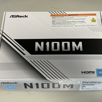
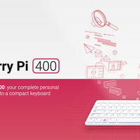
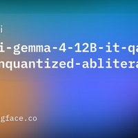

<div class="doc-header">
  <div class="doc-title">Hermes Agent の住処を N100 とラズパイに作る</div>
</div>

# Hermes Agent の住処を N100 とラズパイに作る

<aside class="publication-note">
  <div class="publication-note-label">Information</div>
  <div class="publication-note-text">これは 2026 年 10 月 18 日にブログで掲載しました。適宜、加筆修正しています。</div>
  <div class="publication-note-url">掲載元：https://mthr.hatenablog.com/entry/2026/10/18/192710</div>
</aside>

とある日のポストにて、たしかに Hermes Agent はよく耳にするが、実際に使ったことはないなーと。

<div class="link-card x-post-card">
  <div class="link-card-body">
    <div class="link-card-title">珠音こころ(Tamaneko)（@tamanekokoro）の投稿 / X</div>
    <div class="link-card-text">ほんまにAIやってる人は一家に一台省電力ミニPCでも置いてHermes Agentの住処にすべきですよ🔥</div>
    <div class="link-card-url">引用先：https://x.com/tenhkspark/status/2108646840669540727</div>
    <div class="link-card-url">https://x.com/tamanekokoro/status/2108775617609298426</div>
  </div>
</div>

そういえば、組んだはいいが、使っていない N100 マシンがあります。このマシンのマザーボードは PCIe 3.0 x16 があるので、グラボを搭載できます。つまり、ローカル LLM を動かせます。このマシンで、Hermes Agent を構築しました。その記録です。

<div class="link-card">
  
  <div class="link-card-body">
    <div class="link-card-title">Intel N100 を搭載したマザーボード ASRock N100M を購入したよ - mthr blog</div>
    <div class="link-card-url">https://mthr.hatenablog.com/entry/2026/05/31/115701</div>
  </div>
</div>

さらに、以前のイオシスのセールで購入したキーボード型のラズパイを購入したまま、放置しておいたので、これでも動かしてみます。このラズパイ単体では LLM を動かすのは無理なので、推論は API サービスを利用します。

<div class="link-card">
  
  <div class="link-card-body">
    <div class="link-card-title">Buy a Raspberry Pi 400 Personal Computer Kit – Raspberry Pi</div>
    <div class="link-card-url">https://www.raspberrypi.com/products/raspberry-pi-400/</div>
  </div>
</div>

## Hermes Agent とは

Hermes Agent とは、AI 研究機関の Nous Research が 2026 年 2 月に公開した、使えば使うほど成長するオープンソースの自律型 AI エージェントです。従来の AI チャットと異なり、サーバーやローカル環境に常駐し、あなたの専属アシスタントとしてタスクをこなします。

<div class="link-card">
  
  <div class="link-card-body">
    <div class="link-card-title">Hermes Agent — The Agent That Grows With You</div>
    <div class="link-card-url">https://hermes-agent.nousresearch.com/</div>
  </div>
</div>

### インストール

Windows では、Microsoft Store で公開されるので、クリックするだけでインストールできます。

<div class="link-card">
  
  <div class="link-card-body">
    <div class="link-card-title">Hermes Agent - Free download and install on Windows | Microsoft Store</div>
    <div class="link-card-url">https://apps.microsoft.com/detail/9PMXK8CZC7KR?hl=neutral&amp;gl=JP&amp;ocid=pdpshare</div>
  </div>
</div>

他の Linux や macOS は次のコマンドを使って対話型でインストールできます。

```bash
curl -fsSL https://hermes-agent.nousresearch.com/install.sh | bash
```

## 環境構築

インストール全般は簡単なので省略します。私の環境での設定をまとめます。今回は次の 2 つの環境で Hermes Agent を構築しました。

| マシン | 内容 |
| :-- | :-- |
| N100 | Hermes Agent 内蔵の llama.cpp によるローカル推論と、API の LLM を組み合わせた環境 |
| ラズパイ（Raspberry Pi 400） | API の LLM のみを利用する軽量環境 |

Hermes Agent をどこからでも利用できるようにテレグラムと連携します。基本的にテレグラム経由で利用します。Slack も考えましたが、テレグラムのほうが簡単に設定できたので採用しました。

## LLM のバックエンド

API で利用する LLM のバックエンドには、「さくらの AI Engine」を利用しました。テキスト生成で、月 3000 回のリクエストが無料で利用できます。

<div class="link-card">
  
  <div class="link-card-body">
    <div class="link-card-title">さくらのAI Engine | さくらのAI | 生成AI・GPUクラウドサービス</div>
    <div class="link-card-url">https://ai.sakura.ad.jp/sakura-ai/ai-engine/</div>
  </div>
</div>

月 3000 回が無料なので、チャットで聞くには十分な無料枠です。ちなみに、さくらの AI Engine は Kimi-K2.7 もサポートしており、実際の開発補助にも使えそうだなと思ってます。そのときは無料から従量課金に変更ありかもですね。

### API キーの設定

API を利用するため、API キーを env.yml に定義します。

```yaml
SAKURA_AI_API_KEY="your-api-key"
```

## N100 マシンの設定

N100 マシンの構成は次のとおりです。当初は Windows 11 でセットアップしていましたが、常時起動も考慮して、Windows より負荷が小さい Ubuntu に入れ替えました。

| 構成 | 性能 |
| :-- | :-- |
| CPU | Intel N100 |
| メモリ | DDR4 32GB（シングル） |
| GPU | Geforce 3060 12GB |
| OS | Ubuntu 26.04.1 |

N100 マシンの config は、グラボを活かしてローカル LLM を動かしつつ、さくらの AI Engine も併用できるように設定しています。

```yaml
model:
  default: Huihui-gemma-4-12B-it-qat-q4_0-unquantized-abliterated-Q4_K
  provider: llamacpp
local_runtime:
  enabled: true
providers:
  llamacpp:
    api: http://127.0.0.1:18434/v1
    transport: chat_completions
  sakura:
    api: https://api.ai.sakura.ad.jp/v1
    key_env: SAKURA_AI_API_KEY
    transport: chat_completions
```

<!-- 原文の疑問符を含む語り口を維持する。 -->
<!-- textlint-disable ja-technical-writing/no-exclamation-question-mark -->

ローカル LLM は、本音をぶつけ合う？　のも想定して、gemma 4 14B の非検閲版を採用しました。12GB の VRAM にぴったり乗るサイズです。なお、非検閲版にしてますが、何を聞けばよく分かってなく、まあ秘密の会話をするかも？　とざっくり選びました。

<!-- textlint-enable ja-technical-writing/no-exclamation-question-mark -->

<div class="link-card">
  
  <div class="link-card-body">
    <div class="link-card-title">huihui-ai/Huihui-gemma-4-12B-it-qat-q4_0-unquantized-abliterated · Hugging Face</div>
    <div class="link-card-url">https://huggingface.co/huihui-ai/Huihui-gemma-4-12B-it-qat-q4_0-unquantized-abliterated</div>
  </div>
</div>

この config はローカルと API の LLM を切り替える運用を想定しています。テレグラムでは`/model`コマンドで LLM のモデルを GUI で切り替えることができます。しかし、この切り替えは API モデルを想定していて、ローカルの切り替えをすると問題が起こります。これは issue に起票済みでした。

別の手法として、`/model {モデル名}`で切り替えることができます。しかし、モデル名が長く現実的ではないです。そこで、エイリアス機能を利用します。たとえば、次のように設定することで、`/model local`でローカル LLM を切り替えることができます。

<figure class="column-top">

```yaml
# ---------------------------------------------------------------
# モデルのエイリアス（短縮名）
# /model <短縮名> で切り替わる
# ---------------------------------------------------------------
model_aliases:
  local:
    model: Huihui-gemma-4-12B-it-qat-q4_0-unquantized-abliterated-Q4_K
    provider: llamacpp
  sakura:
    model: gpt-oss-120b
    provider: custom:sakura
    key_env: SAKURA_AI_API_KEY
```

</figure>

ここで、さくらの AI Engine は国産の`llm-jp-3.1-8x13b-instruct4`も用意されています。利用しましたが、エラーになりました。config を編集しましたが、うまくいかず。いまは、gpt-oss-120b か gemma-4-31B-it をよく利用しています。

## ラズパイの設定

キーボード型で手軽なラズパイ（Raspberry Pi 400）では、マシンパワーを考慮して「さくらの AI Engine」のみをプロバイダとして指定するシンプル構成にしています。

```yaml
providers:
  sakura:
    api: "https://api.ai.sakura.ad.jp/v1"
    key_env: "SAKURA_AI_API_KEY"
    transport: "chat_completions"
    api_mode: "chat_completions"
    extra_body:
      enable_auto_tool_choice: false

model:
  provider: "custom:sakura"
  default: "gpt-oss-120b"
```

## まとめ

Hermes Agent は無事に導入できました。当初はラズパイから環境構築を進めていたので、レスポンスの遅さ（Hermes ではなく、ラズパイ自体のレスポンス）から途中で心折れそうでした。しかし、途中で N100 に切り替え、分からないことを AI に聞き進めたら、あっさりできました。

いま、N100 とラズパイの Hermes Agent が私のテレグラムにいます。正直、両者をどう使い分けるか分からないですが、適当に使っています。消費電力を考えるとラズパイですが、せっかく非検閲版のローカル LLM を置いたので、なにか考えて活用したいですね。
