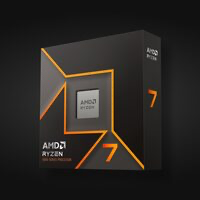
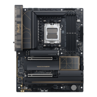
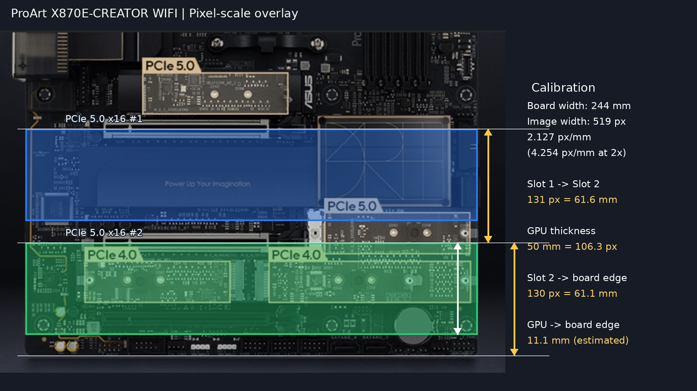
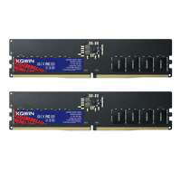
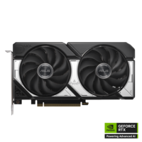
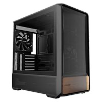
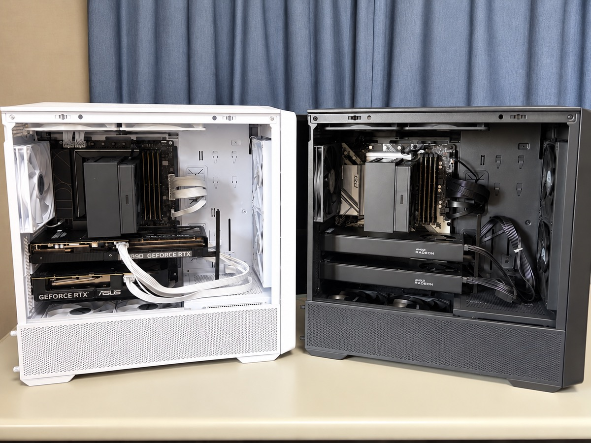

  
ローカル LLM 素人が作るローカル LLM 検証機（２台目）

# ローカル LLM 素人が作るローカル LLM 検証機（２台目）

<aside class="publication-note">
  
Information

  
これは 2026 年 10 月 28 日にブログで掲載しました。適宜、加筆修正しています。

  
掲載元：https://mthr.hatenablog.com/entry/2026/10/28/181140

</aside>

<!-- textlint-disable -->

以前、「[ローカル LLM 素人が作るローカル LLM 検証機](https://qiita.com/mitsuharu_e/items/92a3eccb65d9b5c4ceca)」という記事を書きました。自作 PC 趣味の延長でローカル LLM に手を出し、気が付いたら Radeon AI PRO R9700 32 GB を2枚搭載した検証機ができていました。

  
  

    
ローカル LLM 素人が作るローカル LLM 検証機 - Qiita

    
https://qiita.com/mitsuharu_e/items/92a3eccb65d9b5c4ceca

  

ローカル LLM を色々と試しているうちに、NVIDIA の CUDA が使える環境も欲しくなりました。Geforce を搭載したサブ検証機を触ると、Radeon とは違って痒い所に手が届くなと、いつも関心していました。さらに、最近は GPU の VRAM にモデルを収めるだけでなく、CPU やシステムメモリも活用する推論エンジンが出てきました。LLM を目的としたマシン設計の定番がひっくり返りましたね。

というわけで、2台目の検証機を組みました。今回も自作 PC 趣味の延長なので、パーツの選択には勢いや予算の都合が多分に含まれています。この記事では構成と選定理由を紹介し、前回の検証機との違いを整理します。

なお、以前作成した検証機を１号機、今回作成した検証機を２号機と呼称します。

## 検証機のコンセプトとゴール

１号機のコンセプトは「小中規模のモデルを円滑に動かす」でした。大容量 VRAM を確保するために Radeon AI PRO R9700 を２枚搭載しています。

２号機では、次の3点を重視しました。

- CUDA に対応した環境を用意する

  - NVIDIA GPU を利用するソフトウェアや推論エンジンを検証する
- GPU 以外のリソースも活用する

  - 最近流行りの CPU やシステムメモリを使った推論に備える
- マルチ GPU を無理なく収める

  - PCIe のレーン構成だけでなく、スロットの位置、GPU の厚さ、冷却の隙間も考慮する

特に気になっているのは、[Strata](https://github.com/Niko1221/Strata) のように、GPU の VRAM だけでなく CPU やシステムメモリも利用する推論エンジンです。CPU 側にも処理を分担させるなら、GPU 以外の性能も重要になるのではないかと考えました。ただし、実際にどの程度の差が出るかは、後で計測してみないと分かりません。

  
  

    
GitHub - Niko1221/Strata: Qwen3.8-Flash-Next on any consumer hardware: one-click install for Windows / Linux. Strata inference engine, OpenAI/Anthropic API on localhost, optional image input.

    
https://github.com/Niko1221/Strata

  

OS は今のところ Windows 11 のままです。他の検証機で Ubuntu を利用していますが、こちらは Windows で使う予定です。

## 検証機の構成

今回の２号機は次の構成です。パーツはセールや格安品を買ったり、中古やフリマサイトを日々確認して集めてきました。安く組んだつもりですが、正直高いですね...

| パーツ | 製品・構成 |
| :-- | :-- |
| OS | Windows 11 Home |
| CPU | AMD Ryzen 7 9700X |
| CPU クーラー | ドスパラセレクト A400F-BK |
| マザーボード | ASUS ProArt X870E-CREATOR WIFI |
| システムメモリ | KOWIN EU5600 DDR5-5600 128 GB（32 GB × 4） |
| SSD | 手持ちの NVMe SSD 2 TB |
| GPU 1 | INNO3D GeForce RTX 5070 Ti X3 16 GB |
| GPU 2 | ASUS Dual GeForce RTX 5060 Ti 16 GB |
| GPU の VRAM 合計 | 32 GB（16 GB + 16 GB） |
| 電源 | ドスパラセレクト 1000W-GOLD-ATX31-WH |
| ケース | Okinos Air Cross White |

### CPU：AMD Ryzen 7 9700X

  
  

    
AMD Ryzen™ 7 9700X

    
https://www.amd.com/en/products/processors/desktops/ryzen/9000-series/amd-ryzen-7-9700X.html

  

いつぞやの Amazon のセールで安くなっていたため、勢いでポチって、そのまま寝かせていた CPU です。今回ようやく出番が来ました。

Ryzen 7 9700X は Zen 5 世代の 8 コア 16 スレッド CPU で、AVX-512 命令に対応しています。CPU 側で演算する推論エンジンでは、AVX-512 に対応した処理を高速化できる可能性があります。当初からローカル LLM のために買ったわけではありませんが、GPU 以外のリソースを活用するという今回のコンセプトには、ちょうどよい CPU でした。

### CPU クーラー：ドスパラセレクト A400F-BK

  
  

    
ドスパラセレクト A400F-BK (ブラック) ｜ パソコン通販のドスパラ【公式】

    
https://www.dospara.co.jp/SBR1968/IC583089.html

  

Ryzen 7 9700X は標準 TDP が 65 W の CPU です（設定によっては 105 W モードで運用できますが）。今回は扱いやすさとコストを重視して空冷クーラーを選びました。

選んだのは１号機と同じ A400F-BK です。選定理由はシンプルで、安いからです。

### マザーボード：ASUS ProArt X870E-CREATOR WIFI

  
  

    
ProArt X870E-CREATOR WIFI｜マザーボード｜ASUS 日本

    
https://www.asus.com/jp/motherboards-components/motherboards/proart/proart-x870e-creator-wifi/

  

今回の構成で、特に悩んだのがマザーボードです。

以前から、２つの PCIe x16 スロットを x8 / x8 で運用できるマザーボードに憧れがありました。１号機の GPU 用スロットは PCIe 4.0 x16 と PCIe 4.0 x4 の組み合わせだったので、今回は２枚とも十分な帯域を確保できる構成を試してみたかった。このマザーボードは、Ryzen 7000 および 9000 シリーズ との組み合わせで、2つの PCIe 5.0 x16 スロットを x8 / x8で利用できます。

しかし、私がそれ以上に気にしたのは、２つ目の PCIe スロットの位置でした。グラボを２枚挿す場合、PCIe x16 形状のスロットが2つあるだけでは安心できません。下側のスロットがマザーボードの下端に近いと、グラボがフロントパネルの接続ピンやケーブルと干渉します。逆に上過ぎる場合、２枚間に隙間がなければ、冷却にも不利です。

#### ChatGPT にスロット間隔を相談した

ChatGPT にマザーボードのスロット間隔を相談しました。メーカーの写真を見ながら、PCIe スロットの位置と GPU の厚さを確認しました。

採用するグラボの最大厚さは 2.5 スロット分として、マザーボード上に GPU を2枚取り付けた場合のイメージを作ってもらいました。LLM をする場合、より高性能で冷却能力が高い分厚いグラボを選ぶのが良いですが、私の予算感では最大 2.5 スロット（頑張って 3 スロット）が限界だなと判断しました。

グラボ仕様に記載されたサイズからピクセルあたりのサイズを割り出して、作図しました。PCIe スロット間隔を約 61 mm、GPU 厚（2.5 スロット）を 50 mm とした場合、GPU 同士の間と、下側 GPU からマザーボード下端までの余裕を確認しています。

実際に、２つめのスロットに 2.5 スロットのグラボを配置しても問題ありませんでした。素晴らしい。なお、デメリットは高いことです。今回はこのマザーボードにかなり予算を使ってしまいました。

### システムメモリ：KOWIN EU5600 128 GB（32 GB x4）

  
  

    
KWEU560064 (32GB 2枚組)

    
https://www.pc-koubou.jp/products/detail.php?product_id=1136967

  

32 GB × ２枚のキットを２セット購入して、合計 128 GBにしました。この容量は、GPU に収まらないモデルの一部をシステムメモリに置いたり、Strata などの CPU 側で推論処理を実行したりするためです。

本当のところ、DDR5 は高いので回避したかったです。1号機は DDR4 に対応した構成で、メモリ容量を安く確保できました。しかし、今回の Ryzen 7 9700X と X870E の組み合わせでは DDR5 が必要です。購入時点で価格が安かった KOWIN を選びました。セールなどを狙って買い集めました。それでも、128 GB は高いです。

KOWIN はメジャーなメーカーではありません（私が知らないだけかも）が、Micron や Samsung のメモリチップを採用しているので、まあ問題ないでしょう。私が購入したものはすべて Samsung でした。

今回はより高価な 64 GB x2 を避けて、値段を優先して、32 GB x4 にしました。それでも高いが...。DDR5-5600 を４枚搭載しても、DDR5-5600 で動作するとは限りません。Ryzen 7 9700X の公式仕様では、４枚構成のメモリ速度は DDR5-3600 になります。設定をいじれば速度を上げることもできるらしいですが、このままで使っています。

### SSD：手持ちの中古 NVMe SSD 2 TB

ストレージには、別の検証機から取り外した NVMe SSD を流用しました。容量は 2 TBです。

ローカル LLM のモデルは容量が大きいので、本当はもっと広いストレージが欲しいところです。最近はモデル自体のバックアップに家庭内 NAS を利用しています。ただ、この NAS も容量は多くないのが残念。

### GPU 1：INNO3D GeForce RTX 5070 Ti X3 16 GB

  
  

    
INNO3D GeForce RTX™ 5070 Ti X3 | Inno3D - Graphics Cards

    
https://www.inno3d.com/product/inno3d-geforce-rtx-5070-ti-x3

  

今回のメイン GPU です。この製品を選んだ大きな理由は、2 スロット厚の薄型モデルであることです。RTX 5070 Ti は 2.5 〜 3 スロット厚の製品が多いです。２枚挿しするために薄いモデルを探していました。INNO3D X3 の厚さは約41 mmで、今回の構成では大きなメリットになります。

RTX 5070 Ti は VRAM 16 GB の GPU です。搭載 VRAM の容量だけを見ると1号機の Radeon AI PRO R9700 の半分ですが、今回は CUDA に対応した GPU を使ってみることが目的です。また、RTX 5060 Ti 16 GB のサブ検証機で、R9700 より CUDA コアの方が速いのが分かっているので、それも期待しました。

こんなメリットばかりですが、デメリットはやはり高いことです。つらい。

### GPU 2：ASUS Dual GeForce RTX 5060 Ti 16 GB

  
  

    
ASUS Dual GeForce RTX™ 5060 Ti 16GB GDDR7 OC Edition

    
https://www.asus.com/jp/motherboards-components/graphics-cards/dual/dual-rtx5060ti-o16g/

  

２枚目は、検証用として以前から持っていた ASUS Dual GeForce RTX 5060 Ti 16 GB です。

こちらは VRAM 16 GB で、厚さ 50 mmの 2.5スロットモデルです。単体で使うときは気になりませんでしたが、２枚挿しするならもっと薄い製品を買えばよかったと後悔しています。今回、上側に取り付ける RTX 5070 Ti が 2 スロット厚なので、今回の組み合わせなら問題ないです。

なお、２枚の VRAM を合計すると 32 GBですが、32 GB の１つの GPU として扱えるわけではありません。モデルをどのように分割するか、異なる性能の GPU をどこまで活用できるかは、推論エンジンや設定次第です。

### 電源：ドスパラセレクト 1000W-GOLD-ATX31-WH

  
  

    
ドスパラセレクト 1000W-GOLD-ATX31-WH (1000W ホワイト) ｜ パソコン通販のドスパラ【公式】

    
https://www.dospara.co.jp/SBR83/IC594775.html

  

１号機と同じく1000 Wの電源を採用しました。今回はケースが白（後述）なので、電源もホワイトモデルにしました。

私が取り扱うグラボは最大でも RTX 5070 Ti クラスの GPU なので、今回の構成では 1000 W で十分と考えています。

### ケース：Okinos Air Cross White

  
  

    
Okinos Air Cross | 株式会社リンクスインターナショナル

    
https://www.links.co.jp/item/okinos-air-cross/

  

１号機ではブラックの Okinos Air Cross を採用しました。エアフローがよく、使っていて満足していました。

ちょうど色違いのホワイトモデルが発売されたので、２号機にも同じ Air Cross を選びました。マルチ GPU では冷却に気を使うので、使い慣れていて冷却にも満足しているケースを再び選べるのは安心です。

１号機がブラック、２号機がホワイトという組み合わせになりました。

## １号機と２号機の比較

まずはスペックを比較します。

| 項目 | １号機 | ２号機 |
| :-- | :-- | :-- |
| 目的 | 大容量 VRAM を活用する | CUDA と CPU・RAM も活用する |
| OS | Windows 11 | Windows 11 |
| CPU | Intel Core i5-14400 | AMD Ryzen 7 9700X |
| マザーボード | ドスパラ限定 ASRock B760 Pro RS/D4 WiFi | ASUS ProArt X870E-CREATOR WIFI |
| GPU | XFX Radeon AI PRO R9700 32 GB × 2 | INNO3D RTX 5070 Ti 16 GB + ASUS RTX 5060 Ti 16 GB |
| VRAM の合計 | 64 GB | 32 GB |
| システムメモリ | DDR4 128 GB（32 GB x4） | DDR5 128 GB（32 GB x4） |
| GPU 用 PCIe 接続 | PCIe 4.0 x16 + PCIe 4.0 x4 | PCIe 5.0 x8 + PCIe 5.0 x8 |
| ストレージ | 手持ちの NVMe SSD 2 TB | 手持ちの NVMe SSD 2 TB |
| 電源 | 1000 W（ブラック） | 1000 W（ホワイト） |
| ケース | Okinos Air Cross（ブラック） | Okinos Air Cross（ホワイト） |

１号機は VRAM の合計容量が64 GBと大きく、比較的大きなモデルを GPU 側に収められることが強みです。一方、２号機は VRAM の合計容量こそ半分ですが、より高速な CUDA に対応し、CPU とシステムメモリを使った推論も試しやすい構成を狙いました。

また、PCIe の接続構成も違います。１号機は PCIe 4.0 x16 と x4、２号機は PCIe 5.0 x8 と x8 です。正直なところ、他の検証で PCIe の性能は大きく LLM 推論に影響しませんが、精神的な満足は大きく異なります。

## 性能比較

気になる性能は、ちょっと長くなりそうなので、別記事で書きますね。速報値としては、よい数値を出してきますね。

## まとめ

1号機では VRAM の容量を重視し、Radeon AI PRO R9700 を2枚搭載しました。2号機では方向性を変えて、CUDA に対応した GeForce を2枚搭載し、CPU とシステムメモリにも余裕を持たせました。

安いパーツを探して買い集めたつもりでしたが、マザーボードと DDR5 メモリ、GPU はかなり高くなりました。趣味の検証機なので、そこは割り切るしかありません。

2台それぞれに得意なことがあるはずなので、実際に Ollama や推論エンジンを動かしながら比較していきます。どこまで差が出るのか、今から楽しみです。

<!-- textlint-enable -->
