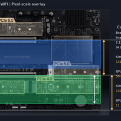

<div class="doc-header">
  <div class="doc-title">ローカル LLM 素人が作るローカル LLM 検証機（パフォーマンス比較編）</div>
</div>

# ローカル LLM 素人が作るローカル LLM 検証機（パフォーマンス比較編）

<aside class="publication-note">
  <div class="publication-note-label">Information</div>
  <div class="publication-note-text">これは 2026 年 10 月 29 日にブログで掲載しました。適宜、加筆修正しています。</div>
  <div class="publication-note-url">掲載元：https://mthr.hatenablog.com/entry/2026/10/29/180000</div>
</aside>

<!-- textlint-disable -->

先日、新しい LLM 検証機を製作して、私の LLM 検証機は（今のところ）２台になりました。今回は、その２台の検証機のパフォーマンス比較を行います。検証機の製作記事をまだの方はご覧ください。

<div class="link-card">
  
  <div class="link-card-body">
    <div class="link-card-title">ローカル LLM 素人が作るローカル LLM 検証機 - Qiita</div>
    <div class="link-card-url">https://qiita.com/mitsuharu_e/items/92a3eccb65d9b5c4ceca</div>
  </div>
</div>

<div class="link-card">
  
  <div class="link-card-body">
    <div class="link-card-title">ローカル LLM 素人が作るローカル LLM 検証機（２台目） - mthr blog</div>
    <div class="link-card-url">https://mthr.hatenablog.com/entry/2026/10/28/181140</div>
  </div>
</div>

今回は、それら検証機のパフォーマンスを計測します。取り扱う計測対象は、次のとおりです。

- Ollama 0.40.12
- Strata 0.27.0

## 検証環境

以前作成した検証機を１号機、今回作成した検証機を２号機と呼びます。

- １号機：Radeon AI PRO R9700（32 GB）×2
- ２号機：GeForce RTX 5070 Ti（16 GB）＋ GeForce RTX 5060 Ti（16 GB）

VRAM の合計は １号機が 64 GB、２号機が 32 GB で、倍の差があります。そのなかで、GeForce（CUDA）と Radeon（ROCm）はどこまで戦えるのかが気になるところです。

### マシンスペック

| 項目 | １号機 | ２号機 |
| :-- | :-- | :-- |
| 目的 | 大容量 VRAM を活用する | CUDA と CPU・RAM も活用する |
| OS | Windows 11 | Windows 11 |
| CPU | Intel Core i5-14400 | AMD Ryzen 7 9700X |
| マザーボード | ドスパラ限定 ASRock B760 Pro RS/D4 WiFi | ASUS ProArt X870E-CREATOR WIFI |
| GPU | XFX Radeon AI PRO R9700 32 GB × 2 | INNO3D RTX 5070 Ti 16 GB + ASUS RTX 5060 Ti 16 GB |
| VRAM の合計 | 64 GB | 32 GB |
| システムメモリ | DDR4 128 GB（32 GB x4） | DDR5 128 GB（32 GB x4） |
| GPU 用 PCIe 接続 | PCIe 4.0 x16 + PCIe 4.0 x4 | PCIe 5.0 x8 + PCIe 5.0 x8 |
| GPU のバックエンド | ROCm 7.1 | CUDA 13 |

### GPU のスペック

LLM の出力速度は、メモリ帯域でほぼ決まると言われます。トークンを 1 つ出すたびに、モデルの重みをメモリから読み出す必要があるからです。

| 項目 | Radeon AI PRO R9700 | RTX 5070 Ti | RTX 5060 Ti |
| :-- | :-- | :-- | :-- |
| アーキテクチャ | RDNA 4 | Blackwell | Blackwell |
| VRAM | 32 GB GDDR6 | 16 GB GDDR7 | 16 GB GDDR7 |
| メモリバス | 256 bit | 256 bit | 128 bit |
| メモリ帯域 | 640 GB/s | 896 GB/s | 448 GB/s |
| TBP / TGP | 300 W | 300 W | 180 W |

帯域だけで見ると、R9700 は 5060 Ti の約 1.4 倍あり、5070 Ti の約 0.7 倍です。

## Ollama

Ollama を利用して、10 回計測した平均を使っています。検証方法は、自作の Agent Skill（[benchmark-ollama-llm](https://github.com/mitsuharu/agent-skills/blob/main/skills/benchmark-ollama-llm/SKILL.md)）にまとめています。

<div class="link-card">
  
  <div class="link-card-body">
    <div class="link-card-title">agent-skills/skills/benchmark-ollama-llm/SKILL.md at main · mitsuharu/agent-skills</div>
    <div class="link-card-url">https://github.com/mitsuharu/agent-skills/blob/main/skills/benchmark-ollama-llm/SKILL.md</div>
  </div>
</div>

### 対象モデル

| モデル | サイズ | 量子化 | １号機での載り方 | ２号機での載り方 |
| :-- | :-- | :-- | :-- | :-- |
| gemma4:12b | 8.0 GB | Q4_K_M | R9700 1 枚（CPU 直結スロット） | RTX 5070 Ti 1 枚 |
| qwen3.8:27b | 17.7 GB | Q4_K_M | R9700 2 枚に分割 | 5070 Ti と 5060 Ti に分割 |

どの GPU に載ったかは、Ollama のログ（`server.log`）で確認しました。どちらのモデルも、全層が GPU に載っていて CPU には溢れていません。

Ollama は、1 枚に収まるモデルなら「空き VRAM が多い GPU」を 1 枚選びます。何も設定しないと、２号機の gemma4:12b は空きが 0.1 GB だけ多かった 5060 Ti に載ってしまいました。リクエストのオプションに `main_gpu` を入れると、そのとおりの GPU に載せてくれたので、5070 Ti の結果はこれで測っています（参考として 5060 Ti の結果も載せます）。

```json
{ "model": "gemma4:12b", "options": { "main_gpu": 0 } }
```

１号機の 2 枚の R9700 は、CPU 直結の PCIe 4.0 x16 スロットと、チップセット経由の PCIe 4.0 x4 スロットに挿さっています。何も設定しないと、Ollama はチップセット側（x4）を先に選んでいました。スロットによって速度が変わったので、gemma4:12b は CPU 直結スロット側の結果を使っています（１号機は、片方の GPU に別のモデルを常駐させてもう片方に載せる方法で切り替えました）。

### gemma4:12b（GPU 1 枚に載る）

| 項目 | １号機（R9700、CPU 直結 x16） | ２号機（RTX 5070 Ti） | 差 |
| :-- | :-- | :-- | :-- |
| 出力速度 | 95.68 tok/s | 164.56 tok/s | ２号機が約 1.72 倍 |
| 入力速度 | 730.31 tok/s | 1,214.26 tok/s | ２号機が約 1.66 倍 |
| 出力前の待ち時間 | 0.154 秒 | 0.086 秒 | - |
| 思考時間 | 8.044 秒 | 4.875 秒 | - |
| 回答時間 | 13.180 秒 | 7.555 秒 | - |
| 1 回の合計 | 21.379 秒 | 12.516 秒 | ２号機が約 41 % 短い |

参考として、同じ条件で GPU を変えた結果も並べておきます。

| GPU | 出力速度 | 1 回の合計 |
| :-- | :-- | :-- |
| RTX 5070 Ti（２号機） | 164.56 tok/s | 12.516 秒 |
| RTX 5060 Ti（２号機） | 103.00 tok/s | 19.968 秒 |
| R9700、CPU 直結 x16（１号機） | 95.68 tok/s | 21.379 秒 |
| R9700、チップセット x4（１号機） | 89.28 tok/s | 22.925 秒 |

１号機の結果を見ると、PCIe x16 と x4 ではすべてが VRAM に載る場合は、さほど大きな差がないことが分かりました。

### qwen3.8:27b（GPU 2 枚に分割）

| 項目 | １号機（R9700 ×2） | ２号機（5070 Ti ＋ 5060 Ti） | 差 |
| :-- | :-- | :-- | :-- |
| 出力速度 | 48.72 tok/s | 67.78 tok/s | ２号機が約 1.39 倍 |
| 入力速度 | 302.74 tok/s | 530.08 tok/s | ２号機が約 1.75 倍 |
| 出力前の待ち時間 | 0.179 秒 | 0.106 秒 | - |
| 思考時間 | 11.605 秒 | 6.802 秒 | - |
| 回答時間 | 30.439 秒 | 23.416 秒 | - |
| 1 回の合計 | 42.223 秒 | 30.324 秒 | ２号機が約 28 % 短い |

どの計測も 10 回のばらつきは小さく、出力速度の最小と最大の差はほとんどが 1 tok/s 前後でした。

### 考察

やはり、CUDA か...。１号機の方は CPU、メモリやマザーボードが前世代モデルなので不利とはいえ、こうも完敗するとは (´；ω；｀)ｳｯ…。対照実験として Radeon を２号機に載せ替えれば、と期待はしますが、VRAM にすべて載る gemma4 の結果を見る限り、逆転は期待薄いです。

#### １枚なら 5070 Ti が圧勝、帯域の差以上に開く

gemma4:12b では、5070 Ti が R9700 の約 1.72 倍の速さでした。メモリ帯域の差は約 1.4 倍（896 GB/s と 640 GB/s）なので、それ以上に差が開いています。さらに、帯域が R9700 の 0.7 倍しかない 5060 Ti にも、R9700 は 1 割弱負けています。帯域 100 GB/s あたりの出力速度に直すと、差がはっきりします。

| GPU | メモリ帯域 | 出力速度 | 帯域 100 GB/s あたり |
| :-- | :-- | :-- | :-- |
| RTX 5060 Ti | 448 GB/s | 103.00 tok/s | 約 23.0 tok/s |
| RTX 5070 Ti | 896 GB/s | 164.56 tok/s | 約 18.4 tok/s |
| R9700（x16） | 640 GB/s | 95.68 tok/s | 約 14.9 tok/s |

Windows での ROCm は、CUDA に比べるとまだ最適化が進んでいない部分があるのかもしれません。しかしながら、裏で ROCm 10 版の検証も実行しましたが、結果はお察しください。ただし、2 台は CPU（Core i5-14400 と Ryzen 7 9700X）、メモリ（DDR4 と DDR5）、GPU の接続（PCIe 4.0 と PCIe 5.0）も違うので、すべてを GPU のせいにはできません。GPU の入れ替えは面倒なので、交換しての検証はスキップします。

#### 2 枚に分割すると、遅いほうのカードに引っ張られる

qwen3.8:27b では、gemma4 であった差が 1.72 倍から 1.39 倍に縮みました。モデルが異なるので、直接比較はできませんが、２号機が分割で影響したからでしょう。

| 機種 | gemma4:12b（1 枚） | qwen3.8:27b（2 枚） | 落ち込み |
| :-- | :-- | :-- | :-- |
| １号機 | 95.68 tok/s | 48.72 tok/s | 約 0.51 倍 |
| ２号機 | 164.56 tok/s | 67.78 tok/s | 約 0.41 倍 |

分割して動かすと、トークンを 1 枚目、そして 2 枚目の GPU で処理します。つまり、1 トークンの時間は「それぞれのカードが受け持つ層の処理時間の合計」になります。２号機は、半分ほどの層を遅い 5060 Ti が受け持つので、5070 Ti の速さが活きません。

ざっくり見積もってみます。gemma4:12b の結果から「重み 1 GB あたりの処理時間」をカードごとに出し、ログに出ていた qwen3.8:27b の各カードの担当量（２号機は 5070 Ti に約 7.7 GB、5060 Ti に約 7.3 GB）を掛けて足すと、1 トークンあたり １号機が約 23.6 ミリ秒、２号機が約 17.1 ミリ秒になります。実測（20.5 ミリ秒と 14.8 ミリ秒）よりどちらも 15 % ほど長めですが、比は約 1.38 倍で、実測の 1.39 倍とほぼ一致します。２号機の 1 トークンの時間のうち、6 割ほどは 5060 Ti の担当分という計算です。

１号機も、半分の層をチップセット側（x4）のカードが受け持っています。2 枚の間のデータのやりとりも、２号機は PCIe 5.0 x8 同士なのに対して、１号機は片方がチップセット経由の PCIe 4.0 x4 です。

#### １号機の qwen3.8:27b は、本来なら 1 枚に収まる

実は １号機の qwen3.8:27b は、R9700 1 枚（32 GB）に十分収まるサイズです。それでも 2 枚に分割されたのは、コンテキスト長の既定値のせいでした。

Ollama は、VRAM の合計からコンテキスト長の既定値を決めます。

- １号機（VRAM 64 GB）：262,144
- ２号機（VRAM 32 GB）：32,768

１号機は KV キャッシュだけで 17 GB ほど確保していて、モデル本体と合わせると 1 枚には収まらなかった、というわけです。`OLLAMA_CONTEXT_LENGTH` で 32,768 などに減らせば、1 枚（CPU 直結スロット側）で動かせるはずです。ただ、上の見積もりでいくと、R9700 1 枚（x16）でも 1 トークンあたり 20 ミリ秒ほど、出力速度は 50 tok/s 前後で、今より数 % 速くなる程度かもしれません。分割をやめても、R9700 の 1 GB あたりの処理時間そのものは変わらないからです。これは次に試したいと思います。

### 思考時間の差は、速度だけの差ではない

思考時間は、qwen3.8:27b で １号機が 11.6 秒、２号機が 6.8 秒と大きく開いています。ただし、思考の文字数も １号機が 1,974 文字、２号機が 1,680 文字と違っています。temperature 0 でも、GPU が違うと計算結果が少しずれて、出てくる文章が変わるようです。同じ ２号機の gemma4:12b でも、思考の文字数は 5070 Ti が 3,117 文字、5060 Ti が 3,184 文字と違っていました。

gemma4:12b は、１号機が 2033 トークンで回答を終え、２号機は 2048 トークンの上限で打ち切られています。速度を比べるときは、時間より出力速度（tok/s）を見たほうがよさそうです。

### まとめると

| 指標 | １号機に対する ２号機の倍率 |
| :-- | :-- |
| gemma4:12b の出力速度（1 枚） | 約 1.72 倍 |
| qwen3.8:27b の出力速度（2 枚に分割） | 約 1.39 倍 |
| gemma4:12b の 1 回の合計時間 | 約 0.59 倍（41 % 短い） |
| qwen3.8:27b の 1 回の合計時間 | 約 0.72 倍（28 % 短い） |
| VRAM 合計 | 0.5 倍 |

速さだけなら ２号機の勝ちです。特に 16 GB に収まるモデルを 5070 Ti で動かすのが一番速いです。ただし、１号機は VRAM が倍あるので、２号機では GPU に載り切らないモデルも動かせます。そういうモデルでは、CPU に溢れる ２号機より １号機のほうが、ずっと速いと思います。ただし、Strata が発表された現在では...。

## Strata

Strata は Qwen3.8-Flash-Next 専用の推論エンジンです。125B の MoE モデルですが、1トークンで使うのは約6B だけです。よく使う expert を VRAM に、全部の expert を RAM に置いて、PC 全体をメモリ階層として使います。そのため、大容量な VRAM は不要です。

<div class="link-card">
  
  <div class="link-card-body">
    <div class="link-card-title">GitHub - Niko1221/Strata: Qwen3.8-Flash-Next on any consumer hardware: one-click install for Windows / Linux. Strata inference engine, OpenAI/Anthropic API on localhost, optional image input.</div>
    <div class="link-card-url">https://github.com/Niko1221/Strata</div>
  </div>
</div>

### 比較

Strata のチャット画面からいくつかのプロンプトを送り、回答の下に出るトークン数と tok/s を記録しました。どちらも考えるモード（Thought）が有効です。なお、Strata の設定は基本的にレコメンドを選んで、両者が同じ設定になるようにしました。

| 項目 | １号機 | ２号機 |
| :-- | :-- | :-- |
| 思考時間 (秒) | 12.1 | 11.4 |
| トークン数 | 1,402 | 1,168 |
| 生成速度 (token/s) | 110.5 | 95.8 |

| 項目 | １号機 | ２号機 |
| :-- | :-- | :-- |
| 思考時間 (秒) | 26.1 | 9.2 |
| トークン数 | 2,741 | 1,152 |
| 生成速度 (token/s) | 96.0 | 87.7 |

両者とも 100 token/s 前後でした。大きなモデルなので、VRAM が大きい１号機の圧勝を期待しましたが、あまり差がないですね...

### 考察

Qwen3.8-Flash-Next の expert は全部で 24,576 個あります。１号機はその 96.5%（23,724個）を VRAM に載せていますが、２号機は 34.4%（8,458個）だけです。それでも生成速度はほぼ同じでした。

理由として考えられるのは、使われる expert が偏っていることです。[解説記事](https://akitaonrails.com/en/2026/10/22/best-open-source-llm-strata-with-qwen-3-8-flash-next/)では、RTX 5090（32GB）に expert を 10,000〜11,500 個載せただけで、必要な expert の 90〜97% が VRAM にあったとされています。つまり、ある程度以上載せても、ヒット率はあまり上がらないようです。このモデルに限っては、VRAM 64GB の１号機と 32GB の２号機で大きな差は出ませんでした。

ちなみに、Ryzen 7 5700X + RAM DDR4 64GB + RTX 4070 12GB + Ubuntu 26.04 の環境では、生成速度は 60 token/s ぐらいでした。それと比べたら、１号機は早い（当たり前だ...当たり前であって欲しい）。

## 注意点

- 入力速度は参考程度です。プロンプトが短く、2 回目以降はほとんどキャッシュから処理されていて（gemma4:12b は 55 トークン中 50、qwen3.8:27b は 49 トークン中 45）、実際に処理したのは数トークンだけです。入力速度をきちんと比べるなら、prompt cache を避けるオプション（`bustPromptCache`）をつけて測り直す必要があります。
- コンテキスト長の既定値が、１号機は 262,144、２号機は 32,768 で揃っていません。
- ２号機の gemma4:12b（5070 Ti）は、計測の前に `main_gpu` を指定してモデルを読み込んでおいたので、ロード時間は測っていません。モデルのロード時間は、ディスクキャッシュの状態やほかのモデルが載っていたかでも変わるので、今回は比較から外しました。
- 2 台は CPU、メモリ、マザーボード、PCIe の世代も違うので、GPU だけの差ではありません。
- どちらも Ollama は MTP（Multi-Token Prediction）による投機的デコードを使っていました。出力速度はそれを含めた値です。
- 消費電力は今回は測っていません。
- 試しに、自分でビルドした llama.cpp（１号機は ROCm 10.1、２号機は CUDA 13.4）を Ollama と同じ起動オプションで動かしてみました。結果は Ollama とほぼ同じか少し遅いくらいで（１号機の gemma4:12b は 91.10 tok/s）、ROCm を新しくしても R9700 の伸び悩みは解消しませんでした。この記事では Ollama の結果を使っています。

## まとめ

Ollama

- GPU 1 枚に載る gemma4:12b では、RTX 5070 Ti が R9700 の約 1.72 倍速く、メモリ帯域の差（約 1.4 倍）以上に開いた。R9700 は帯域で下回る RTX 5060 Ti にも 1 割弱負けた
- １号機では、同じ R9700 でも CPU 直結スロット（x16）のほうがチップセット側（x4）より 7 % ほど速く、Ollama は何も設定しないとチップセット側を先に使っていた（詳しくは別の記事にまとめます）
- 2 枚に分割する qwen3.8:27b では、２号機は遅い 5060 Ti に引っ張られて差が約 1.39 倍に縮んだ
- １号機の qwen3.8:27b は、コンテキスト長の既定値が大きいせいで、1 枚に収まるのに 2 枚に分割されていた

Strata

- Strata + Qwen3.8-Flash-Next（IQ3_S）の生成速度は、１号機・２号機とも約96 tok/s でほぼ同じでした
- VRAM が倍ある１号機は expert を 96.5% 載せられますが、生成速度にはほとんど効いていません
- プリフィルは１号機が約1.6倍速かったので、次は長い入力で何回か測って確かめたいです
- １号機は設定を編集しないと Radeon を2枚使いません。GPU 名の表示と Monitor の GPU 指標にもまだ不具合があります

16 GB に収まるモデルを速く動かしたいなら、やはり NVIDIA（CUDA）、それも帯域の太い 5070 Ti が有利です。一方で、R9700 は 1 枚 32 GB の VRAM が強みなので、16 GB のカードでは載らない大きめのモデル（かつ、Strata がサポートしてないモデル）を動かす用途で活きると思います。

## 参考

- [低スペック環境におけるローカル LLM の推論速度 / Intel N100 v.s. Ryzen 7 7700](https://mthr.hatenablog.com/entry/2026/10/04/163705)
- [benchmark-ollama-llm（Agent Skill）](https://github.com/mitsuharu/agent-skills/blob/main/skills/benchmark-ollama-llm/SKILL.md)
- [AMD launches Radeon AI Pro R9700 to challenge Nvidia's AI market dominance（Tom's Hardware）](https://www.tomshardware.com/pc-components/gpus/amd-launches-radeon-ai-pro-r9700-to-challenge-nvidias-ai-market-dominance)
- [Nvidia RTX 5060 Ti 16GB Review（KitGuru）](https://www.kitguru.net/components/graphic-cards/dominic-moass/nvidia-rtx-5060-ti-16gb-review-ft-gigabyte-palit/all/1/)
- [Nvidia RTX 5070 Ti Specs Include 256-bit memory bus and 350W TBP（Guru3D）](https://guru3d.com/story/nvidia-rtx-5070-ti-specs-include-256bit-memory-bus-and-350w-tbp)
- [Best Open Source LLM: Strata with Qwen 3.8 Flash Next](https://akitaonrails.com/en/2026/10/22/best-open-source-llm-strata-with-qwen-3-8-flash-next/)

<!-- textlint-enable -->
